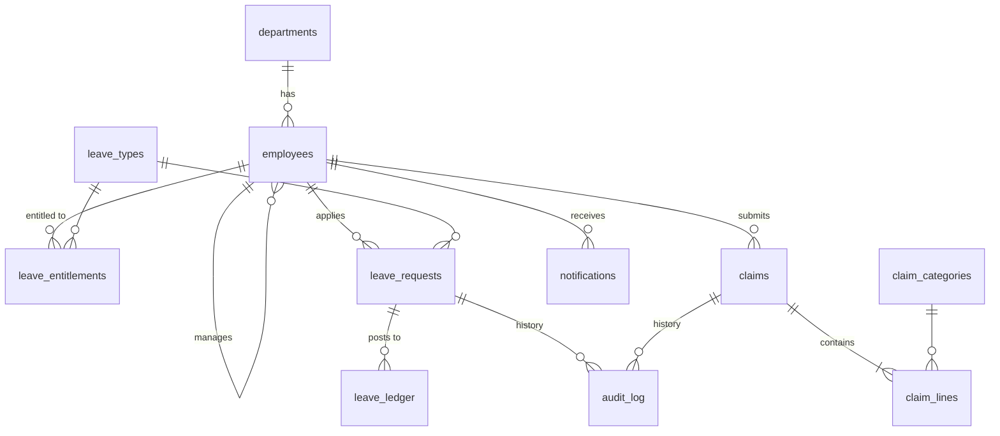

# Workline — a Workday-style Leave & Claims app

A Workday-style HCM clone built for the **Leave & Claims Approval Workflow** (AIA Activities 1.1 and 1.2):
staff apply for leave and submit expense claims on one standard template, the right Department Head
approves within 2 working days, HR's **Master Leave Record** updates itself, and Finance pays approved
claims in the next payroll.

- **Frontend:** Next.js 15 (App Router, TypeScript) — deploys to Vercel with zero config
- **Backend:** Supabase — Postgres, Auth, Row Level Security, Storage, `pg_cron`
- **All business rules live in the database** (PL/pgSQL functions), so they hold whatever client calls them

## What it does

| Activity requirement | Where it lives |
|---|---|
| One online template for leave and for claims | **Time Off** and **Expenses** pages |
| Validate balance, working days (weekends + MOM public holidays), policy | `_evaluate_leave()` — live preview while typing, re-checked on submit and on approval |
| Clash check against teammates' leave | `team_clash` flag + teammates listed to the approver; **Team Calendar** |
| Route to the right supervisor / Department Head; a Head's own leave goes to the Director | `_approver_for()` (line manager, else department head, never yourself) |
| Remind after 1 working day, escalate after 2 | `process_reminders()` — hourly `pg_cron` job, or "Run reminders now" in HR |
| Approve / reject in one click, remark required to reject | **Inbox** → `decide_leave_request()` / `decide_claim()` |
| Approved leave recorded with zero re-keying | `leave_ledger` (Master Leave Record) written inside the approval transaction |
| Balance = contract entitlement − approved days; pro-rating for joiners; sick leave counts toward the hospitalisation cap | `leave_entitlements`, `ensure_entitlements()`, `leave_balances` view |
| Approved claims go straight to Finance; pay with date + reference, or return | **Finance** → `pay_claims()` / `return_claim()`; staff correct & resubmit |
| Staff track status; everyone is notified | status badges, audit trail per request, in-app notifications |
| HR & Finance export CSV for payroll; monthly summary for HR | CSV exports on HR, Finance and **Reports** |
| Time-stamped audit trail | `audit_log`, shown as a timeline on every request |
| Short notice / over limit are flags, not blocks | `short_notice`, `over_limit`, `backdated`, `late_submission`, `escalated` flags |
| Link sign-ins before go-live | A new sign-up is linked to the staff record with the same work e-mail (trigger); no one can "pick a name" |

### Roles

| Role | Can |
|---|---|
| Employee | apply, track, cancel own leave; submit/withdraw/resubmit claims; approve if they manage someone |
| Department Head / manager | decide requests routed or escalated to them; see their team's records |
| HR (Office Manager) | Master Leave Record, balances & entitlements, all requests, workers, public holidays |
| Finance | pay or return approved claims, payroll CSV |
| Admin (Director) | everything above, plus override decisions |

## Database schema



| Table / view | Purpose |
|---|---|
| `departments` | Departments and their head (default approver) |
| `employees` | Worker directory; `user_id` links a Supabase Auth sign-in; `manager_id` = approver; `role` = access |
| `leave_types` | AL, SL, HL, CCL, CL, UL with policy switches (pro-rating, MC required, caps, notice, half days) |
| `leave_entitlements` | Contract entitlement per employee / type / year + carry forward + adjustment |
| `public_holidays` | MOM gazetted holidays 2026–2027 incl. in-lieu days |
| `leave_requests` | Applications (`LV-2026-0001`), status, approver, flags, balance snapshot, escalation |
| `leave_ledger` | **Master Leave Record** — written only by approval / cancellation |
| `leave_balances` (view) | total − taken − pending, per type, honouring caps |
| `claim_categories` | Expense categories with receipt rule, per-line guideline, GL code |
| `claims`, `claim_lines` | Claims (`CL-2026-0001`), lines with receipt numbers and files |
| `audit_log` | Every submit / decision / reminder / escalation / payment |
| `notifications` | In-app inbox for each worker |
| `app_settings` | Reminder & escalation thresholds, late-claim threshold |

**Security:** RLS is on for every table. Staff see their own records; managers see their reporting
line; HR and Finance see what their job needs. Requests, ledger, payments and notifications can only
be written through the `SECURITY DEFINER` functions, which run every validation. Colleagues see each
other's absence as "Out of office" without the leave type. Attachments are in a private
`attachments` bucket, foldered by employee.

Migrations are in [`supabase/migrations`](supabase/migrations), demo data in
[`supabase/seed.sql`](supabase/seed.sql) and the break tests in
[`supabase/tests/workflow_break_tests.sql`](supabase/tests/workflow_break_tests.sql).

## Supabase project

The project **workday-clone** (ref `aplpkbnmkhaztvdczfok`, region Singapore `ap-southeast-1`) already has
all four migrations, the seed data and the hourly reminder job applied.

To recreate it elsewhere: create a project, run the four files in `supabase/migrations` in order in the
SQL editor (or `supabase db push` with the CLI), then run `supabase/seed.sql` if you want the demo org.

## Run locally

```bash
cp .env.example .env.local     # already points at the workday-clone Supabase project
npm install
npm run dev                    # http://localhost:3000
```

## Deploy to Vercel

1. In Vercel, **Add New → Project** and import `shaanliew/workday-clone` (framework is detected as Next.js).
2. Add the two environment variables from `.env.example` (Production + Preview):
   - `NEXT_PUBLIC_SUPABASE_URL`
   - `NEXT_PUBLIC_SUPABASE_PUBLISHABLE_KEY`
3. Deploy.
4. In Supabase → Authentication → URL Configuration, set the **Site URL** to your Vercel URL so
   sign-up confirmation links point back to the app.

Both values are browser-safe; access is enforced by RLS.

## Demo accounts

Fictional company **Lumen Retail Pte Ltd**. Password for all: `Workline#2026`

| E-mail | Who |
|---|---|
| daniel.lim@lumen-demo.sg | Staff, Operations |
| siti.aminah@lumen-demo.sg | Staff, Operations |
| nurul.huda@lumen-demo.sg | Staff, Sales |
| priya.nair@lumen-demo.sg | Staff, HR — July 2026 joiner (AL pro-rated to 7) |
| ahmad.rahman@lumen-demo.sg | Head of Operations |
| jason.teo@lumen-demo.sg | Head of Sales |
| meiling.wong@lumen-demo.sg | Head of Finance (Finance role) |
| kumar.pillai@lumen-demo.sg | Finance Executive (pays claims) |
| sarah.ng@lumen-demo.sg | HR & Office Manager (HR role) |
| grace.tan@lumen-demo.sg | Managing Director (Admin) |

> These are demo credentials in a public repo. Before real use, delete the demo users
> (Supabase → Authentication), replace entitlements and claim limits with contract and finance
> policy figures, and turn on leaked-password protection (Authentication → Passwords).

## Test results (run against the live database)

- Happy path: Daniel AL 4 days → approved by Ahmad → **10/14**; Priya (July joiner) → **3/7**;
  Ahmad's own sick leave → routed to Grace (Director) → **SL 12/14, HL 58/60**;
  Nurul's 3-line claim **SGD 140.30** → approved → paid **PAYROLL-2026-11**.
- Reminder after 1 working day and escalation to the approver's manager after 2; Finance return →
  correct & resubmit; cancelling approved future leave writes a reversal to the Master Leave Record.
- All break cases blocked with a clear message and nothing saved: overlap, over balance, across years,
  no MC, unpaid before annual, holiday-only day, no receipt, no declaration, reject without remark,
  pay without reference, wrong approver, paying an unapproved claim, non-Finance paying, duplicate
  receipt, bad half day, before hire date, future expense date.
- RLS: staff see only their own requests; colleagues' leave types are hidden; direct writes to the
  ledger are refused; internal functions can't be called from the API.
